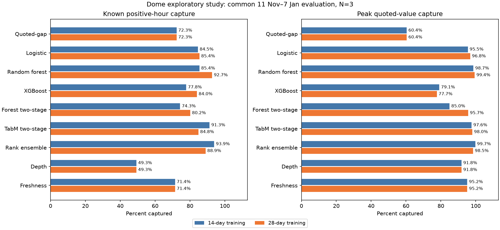

# Dome: shorter training histories and longer forward evaluation

Completed 30 October 2026. This separate exploratory study uses the existing
Dome opportunity dataset. It fits models on the first two or four calendar
weeks, freezes them, and evaluates subsequent development observations. The
longer, earlier evaluation contains enough competing events to distinguish the
policies. Results depend on the training history; no single model wins every
comparison.

The completed [final evaluation](final_evaluation.md) and its fitted models are
preserved. Its January–February outcomes have already been examined. This study
does not change that test boundary or claim a new untouched test. The development
observations used here have also been inspected in earlier research. These are
exploratory comparisons within the frozen cohort, suitable for model analysis
and hypothesis development rather than independent confirmation.

## Data and chronological design

Training begins at the administrative development boundary, 14 October 2025.
The earliest eligible row is 14 October at 20:00 UTC. All times below are UTC;
interval ends are excluded.

| Fit | Training cutoff | Known training rows | Positive training rows | Forward evaluation |
| --- | --- | ---: | ---: | --- |
| 14-day history | 28 October 2025 | 3,770 | 39 | 28 October–8 January: 72 days |
| 28-day history | 11 November 2025 | 7,652 | 110 | 11 November–8 January: 58 days |

The two cutoffs are fixed calendar histories, not the winning boundaries from a
search over performance. A training label's full one-hour window must end
**strictly before** its cutoff. Unknown labels never enter fitting. Each fitted
model remains unchanged throughout its forward interval; this is a fixed-origin
study, unlike the earlier expanding-history folds.

The primary comparison between training histories uses their **identical
58-day interval, 11 November 2025–8 January 2026**:

- 1,392 scheduled hourly scans, all with at least one eligible event.
- 41 events with ranking rows, with a median of 12.5 and a maximum of 19 events
  per scan. There are more than three candidates in 1,384 hours.
- 17,293 event-hours: 14,162 known outcomes and 3,131 unknown outcomes.
- 343 known positive event-hours, from 11 events.

The 14-day fit's longer 72-day evaluation contains 22,322 event-hours, 45 events
and 415 known positive hours. Its pooled results must not be directly compared
with the other fit's shorter interval. Both views are retained in the results.

No raw books, alignment, feature values or opportunity labels are rebuilt.
Original final-period outcomes are neither loaded nor used to choose settings.

## Targets, features and model settings

The first target is whether a qualifying opportunity occurs in the following
hour. The second is the maximum displayed dollar margin of one qualifying
basket at one observed state in that hour. Qualification retains the existing
depth, minimum-order, clean-book and worst-limit-margin checks, with no capital
cap, share cap, persistence requirement or quote-age cutoff. Execution outcomes
do not determine either target. Unknowns remain missing and compete for
monitoring slots before metrics consult their labels.

Occurrence logistic regression, random forest and XGBoost share the **33 book
features**. They include current quoted gap, spread, depth, book age, structural
and quality summaries, and previous scheduled values and changes. The two-stage
forest and TabM share **36 combined features**, adding event type, topic and age.
See [the dataset guide](../dataset.md) for definitions and the saved design for
the exact ordered columns.

Classical models use the original first-declared fixed configurations. There is
no new grid search. TabM uses the original first configuration and 32 implicit
members. It selects epochs on the last calendar quarter of its earlier training
history, using purged earlier fits and known inner labels only. It then refits
the entire permitted training history for each of three fixed seeds. Classifier
and conditional positive-value stages have separate preprocessing and losses.
Their products are averaged across seeds.

The 14-day TabM selects 28 classifier epochs and one amount epoch. The 28-day
fit selects five classifier epochs and 21 amount epochs. These differences
illustrate sensitivity to the small initial training populations, rather than
establishing a generally optimal training duration.

The rank ensemble equally averages within-scan percentile ranks from logistic,
occurrence forest and two-stage TabM. Its membership and weights are fixed.
Quoted-gap, depth and freshness rules are references; random capture is an exact
expectation based on each complete eligible pool. Tie-breaking uses event slug.
N=3 is primary and N=5 secondary.

This compares screening policies with different targets and feature views, not
architecture alone. Classical occurrence models can be compared on the same
features; both two-stage families also share their features. Earlier development
studies contain the broader tuning and feature-ablation analyses.

## Results on the same 58-day interval

Recall is the share of known positive event-hours selected. Value capture is
the share of summed known hourly peak quoted margins selected. Values below
are percentages.

| Policy, N=3 | Recall, 14-day fit | Recall, 28-day fit | Value capture, 14-day fit | Value capture, 28-day fit |
| --- | ---: | ---: | ---: | ---: |
| Quoted-gap | 72.30 | 72.30 | 60.38 | 60.38 |
| Logistic | 84.55 | 85.42 | 95.49 | 96.82 |
| Random forest | 85.42 | **92.71** | 98.69 | **99.40** |
| XGBoost | 77.84 | 83.97 | 79.13 | 77.69 |
| Forest two-stage | 74.34 | 80.17 | 84.98 | 95.66 |
| TabM two-stage | 91.25 | 84.84 | 97.64 | 98.04 |
| Rank ensemble | **93.88** | 88.92 | **99.74** | 98.46 |
| Depth | 49.27 | 49.27 | 91.85 | 91.85 |
| Freshness | 71.43 | 71.43 | 95.16 | 95.16 |
| Expected random | 19.86 | 19.86 | 18.42 | 18.42 |

The 14-day ensemble selects 322 of 343 positives, versus quoted-gap's 248:
**74 additional known positive event-hours**, a 21.57 percentage-point gain.
The 28-day forest selects 318, a gain of 70 hours or 20.41 points. More training
helps the occurrence forest here but does not monotonically improve TabM or the
ensemble. Training history and the selected metric both affect the ordering.

At N=5 the differences narrow. Quoted-gap captures 93.29% of positives and
98.43% of quoted value. Logistic captures 98.83%/approximately 100% with the
14-day history and 99.13%/approximately 100% with the 28-day history. TabM's
28-day recall is 90.67%, below quoted-gap. A newer model does not consistently
dominate this cohort.



These earlier hours offer much more selection pressure than the completed
January–February test, which had only 16 positive hours and at most five
candidates. The new results do not overturn that final-period tie. They show
that the policies differ in a different, richer part of the same dataset.

## Stability, missing outcomes and event concentration

The common interval's summed hourly peak margins are $8,753.69. **83.96%** of
this ranking-weight denominator belongs to December Fed. Repeated liquidity
across hours is not independently collectible money.

Removing December Fed and reranking leaves 247 positive hours. Quoted-gap
captures 80.16%, compared with the 14-day ensemble's 95.95% and the 28-day
forest's 92.31%. Their value capture is 87.66%, 99.58% and 99.31%, respectively.
The observed gains are therefore not entirely confined to December Fed, though
the evidence remains limited to a small, selected cohort.

Paired seven-day block bootstrap intervals use 10,000 draws and nine blocks,
including a shorter final block. The 14-day ensemble's recall improvement over
quoted-gap is 21.57 points, with a conditional 95% interval of 7.76–30.20 points.
The 28-day forest's improvement is 20.41 points, with an interval of 5.43–29.53
points. These are descriptive intervals conditional on the fitted models and
observed cohort. They do not cover model refitting, missing-label uncertainty,
event selection or dependence beyond a block; multiple comparisons are not
adjusted. They are not independent evidence after repeated development analysis.

Unknown selection also differs. At N=3 on the common interval, 22.70% of
quoted-gap's selected rows have unknown outcomes, versus 7.35% for the 28-day
forest and 1.56% for its ensemble. Known-outcome capture cannot establish what
these policies would capture during unrecorded periods. Recording quality may
contribute to learned rankings and measured differences.

## Reproduction and interpretation

[Notebook 17](../../notebooks/17_dome_validation_horizon.ipynb) verifies saved
inputs, fitted populations and metrics, shows comparisons and concentration,
and optionally refits into a fresh output directory. The reporting command
also reloads every model to reproduce all saved forward scores. Reproduce with:

```powershell
.venv/Scripts/python.exe -m src.models.validation_horizon --output results/runs/validation_horizon_new
.venv/Scripts/python.exe -m src.reporting.validation_horizon --output results/runs/validation_horizon_new
```

Implementation is in `src/models/validation_horizon.py` and
`src/reporting/validation_horizon.py`; saved artifacts are in
`results/validation_horizon/`. Dataset, code, metadata, model and result hashes
identify the run. All 2,913 previously protected Dome files remain unchanged;
the new study adds files rather than replacing the completed research.

PMXT development is deferred following the reconstruction audit. Dome remains
the primary dataset. The next economic comparison can evaluate these frozen
rankings with the existing **100 ms total delay, uncapped capital/shares and
displayed-depth constraints**, alongside latency sensitivities. No new fills or
P&L are estimated here. The two-stage quoted-value target is not a profitability
target, and its capture percentage must not be presented as a return.
