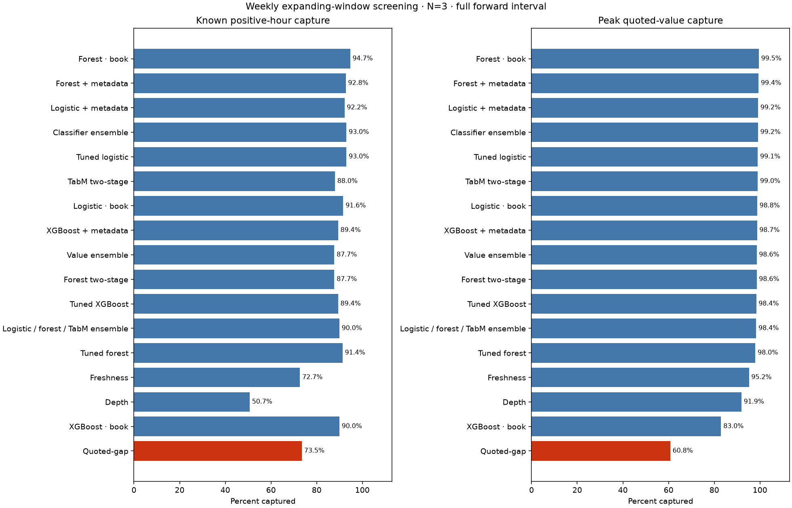
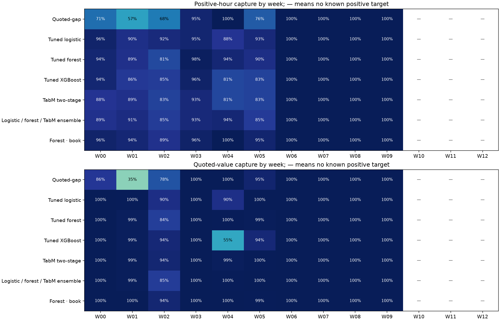

# Weekly expanding-window Dome study

Completed 31 October 2026. This retrospective chronological model-development
study compares 17 policies, weekly refits, earlier-only periodic tuning, and a
separate persistent economic replay. It preserves the earlier completed studies.

## Period, population and target

The dataset spans 14 October 2025–3 February 2026 at 08:00 UTC. The initial
28 calendar days supply training; evaluation runs from **11 November 2025 to
3 February 2026 at 08:00 UTC**, with the endpoint excluded: **84 days 8 hours**.
There are 13 weekly fits, including a final eight-hour evaluation block.
Known training examples grow from 7,652 to 23,452,
with 470 positive examples in the last fitted history. The model
does not remain restricted to its initial 28 days.

The evaluated pool contains 19,766 event-hours from
44 events, 15,787 known labels,
359 positive hours from 12
events, and 3,979 unknown outcomes. Median candidate count
is 9.0, maximum 19;
1,887 hours have more than three candidates.
Calendar span is not complete continuous coverage for every event.

Occurrence means a qualifying basket appears during the next hour. Value is
the maximum qualifying displayed one-basket dollar margin at one state in that
hour. It is not additive hourly profit. Known training windows must finish
strictly before a fitting origin; missing labels never become negatives.
All eligible rows compete before scoring consults their labels.

The new data adapter explicitly joins the already constructed development and
later segments. Their metadata and label contracts are verified, not rebuilt.
Later observations can enter a subsequent training history only after their
target windows have ended. Original final-study artifacts remain unchanged.

## Models, tuning and features

Logistic regression, random forest and XGBoost have fixed book-only and fixed
combined-feature controls, plus tuned combined-feature fits. The fixed views
isolate adding metadata while keeping model settings unchanged. There are 33
book features and 36 combined features. Added metadata is event type, broad
topic and age; event identifiers and realised outcomes are not predictors.
See [the dataset guide](../dataset.md) for exact feature meanings.

Each classical family searches the existing eight settings. Two-stage TabM
searches four declared configurations (original indices 0, 1, 2, 4), using a
probability gate and positive-only value stage. A fixed two-stage forest is a
value reference. TabM uses 32 implicit members per stage, batch size 1,024,
at most 60 epochs and patience 10, a bounded adaptation for this dataset.

Tuning occurs on 11 November, 9 December and 6 January. Every candidate uses
two purged chronological inner blocks ending before its tuning origin. All
families select by captured peak quoted value at N=3, then captured positives,
mean inner average precision and declaration order. TabM uses the first fixed
seed during tuning. Weekly refits average three seed-specific gate × amount
products. Refit epochs are the ceiling of the median selected inner epochs;
settings and epochs carry forward between tuning dates. No weekly evaluation
outcomes choose hyperparameters, early stopping or ensemble weights.
There are 168 inner candidate evaluations. If a tuned setting equals a fixed
control, the weekly bundle shares its fitted artifact rather than treating
identical fits as independent supporting evidence.

Three fixed ensembles average within-scan percentile ranks: the three tuned
classifiers; tuned logistic, tuned forest and TabM; or the two value models.
Quoted-gap, depth and freshness are rule references. Random capture is an exact
candidate-pool expectation. N=3 is primary and N=5 secondary.

## Opportunity prediction

| Policy | Captured positive hours | Recall % | Value capture % |
| --- | --- | --- | --- |
| Forest · book | 340 | 94.71 | 99.53 |
| Forest + metadata | 333 | 92.76 | 99.41 |
| Logistic + metadata | 331 | 92.20 | 99.20 |
| Classifier ensemble | 334 | 93.04 | 99.16 |
| Tuned logistic | 334 | 93.04 | 99.06 |
| TabM two-stage | 316 | 88.02 | 99.04 |
| Logistic · book | 329 | 91.64 | 98.81 |
| XGBoost + metadata | 321 | 89.42 | 98.75 |
| Value ensemble | 315 | 87.74 | 98.58 |
| Forest two-stage | 315 | 87.74 | 98.57 |
| Tuned XGBoost | 321 | 89.42 | 98.40 |
| Logistic / forest / TabM ensemble | 323 | 89.97 | 98.37 |
| Tuned forest | 328 | 91.36 | 98.02 |
| Freshness | 261 | 72.70 | 95.21 |
| Depth | 182 | 50.70 | 91.92 |
| XGBoost · book | 323 | 89.97 | 82.98 |
| Quoted-gap | 264 | 73.54 | 60.76 |

Expected random selection captures
22.23% of
known positive hours and
18.93% of
quoted value at the same N=3 budget. Monitor-all captures all known targets
using the full monitoring pool.

By the primary pooled value-capture criterion, **Forest · book** ranks first
(99.53% value capture,
94.71% positive-hour recall). Quoted-gap captures
60.76% and 73.54%, respectively.
This policy choice is a retrospective comparison of chronological predictions;
it does not change those predictions or establish a universal market winner.

Tuning and ensembles do not consistently improve the fixed baselines. TabM
does not lead this comparison. Adding metadata improves fixed logistic value
capture slightly and fixed XGBoost value capture substantially, while slightly
reducing fixed forest value capture. The matched fixed-feature comparisons are
saved in `analysis/metadata_comparison.csv`.



Weekly metrics, the original earlier/later recording segments, N=5, and a
reranked exclusion of December Fed are reported separately. Weeks with no
known positive target have undefined recall, not zero model performance.
Pooled capture and stability are more informative than a count of weekly wins.



## Economic evaluation

At 100 ms and N=3, the persistent replay gives:

| Policy | Known P&L $ | Attempts | Completed | Unknown attempts |
| --- | --- | --- | --- | --- |
| Forest · book | 5873.32 | 453 | 436 | 0 |
| Forest + metadata | 5873.60 | 456 | 439 | 0 |
| Logistic + metadata | 5892.81 | 434 | 416 | 0 |
| Classifier ensemble | 5902.50 | 462 | 445 | 0 |
| Tuned logistic | 5896.85 | 444 | 426 | 0 |
| TabM two-stage | 5857.99 | 431 | 413 | 0 |
| Logistic · book | 5878.47 | 438 | 420 | 0 |
| XGBoost + metadata | 5915.38 | 449 | 433 | 0 |
| Value ensemble | 5834.01 | 428 | 410 | 0 |
| Forest two-stage | 5921.18 | 454 | 439 | 0 |
| Tuned XGBoost | 5886.61 | 456 | 440 | 0 |
| Logistic / forest / TabM ensemble | 5874.54 | 437 | 419 | 0 |
| Tuned forest | 5881.06 | 466 | 449 | 0 |
| Freshness | 5778.40 | 400 | 384 | 0 |
| Depth | 5745.85 | 285 | 280 | 0 |
| XGBoost · book | 5187.45 | 454 | 437 | 0 |
| Quoted-gap | 4370.05 | 368 | 355 | 0 |

The mean random-policy P&L is $1,123.15 over 20 fixed seeds. These are simulated known returns, excluding and counting unknown outcomes, rather than exchange-confirmed profits.

For the opportunity-selected policy, completed baskets contribute
$6,290.08 and partial baskets contribute
$-416.76. Maximum drawdown is
$206.15; the largest order is
73,067 shares. Its no-settlement funding
scenario requires $1,426,124.21, assuming no
completed-basket settlement cash is released during the study. This is a
funding scenario, not measured deployed capital or an ROI denominator.
Monitor-all produces $5,944.97.
Paired weekly P&L differences are reported separately; execution outcomes did
not choose or train the opportunity model.

**Prediction and economic winners differ.** Forest two-stage has
the highest model P&L ($5,921.18) in this scenario. That
does not replace the opportunity-selected policy or make execution P&L a
learning target. Simple depth and freshness rules also achieve returns close
to the learned policies; most complex-policy differences are small compared
with their improvement over quoted-gap.

**The economic advantage over quoted-gap is concentrated in December Fed.**
After removing it and reranking, the opportunity-selected policy produces
$730.52, versus quoted-gap's $736.36. Thus this
study demonstrates improved opportunity capture within the cohort, but does
not establish a consistent profit advantage across different events.

The primary scenario has **100 ms total source-update-to-order-arrival delay**,
uncapped capital and shares, available-depth sizing, zero imposed failure
probability, immediate submission, frozen decision-time limits and independent
per-leg FOK support. Partial baskets unwind after one second. There is no
quote-age or persistence cutoff. The frozen cohort zero-exchange-fee scenario
and zero additional per-attempt costs are retained.

Every policy and scenario starts empty at the first evaluation hour and retains
its event-level reservations and in-flight state through all weekly refits and
the original January segment boundary. Identical unchanged liquidity is not
repeatedly spent. Required token histories use backward as-of reads bounded by
each token's recording endpoint, with terminal context for outstanding exits.
No cross-event tokens are shared in the replayed universe.

Deterministic policies are evaluated at 0, 50, 100, 250 and 500 ms for N=3/5.
Twenty fixed random seeds run at 100 ms. The December-Fed exclusion reranks
the remaining universe and runs at N=3, 100 ms. Segment and weekly P&L describe
one continuous replay, not independently restarted accounts. Completed basket
margins are booked at completion rather than settlement cash receipt; unlimited
funding is assumed. Monitor-all is a resource reference, not a guaranteed
profit upper bound when trading paths differ.

## Concentration and interpretation

The largest quoted-value contribution is `fed-decision-in-december`:
83.15% of the weighting
denominator. Event contributions, the December-Fed exclusion and paired
seven-day block intervals are saved. There are only 13 blocks, with a short
last block; intervals condition on these fitted policies and this cohort,
not refitting, universe selection or missing-outcome uncertainty. Multiple
policy comparisons are not adjusted.

Late-period candidate competition is weaker than in November–December. Pooled
results therefore need their segment breakdown. Comparisons share the same
hourly candidate pool but known-outcome metrics cannot measure missed
opportunities during unknown recordings. Frozen retrospective membership and
metadata, source-time alignment, recorded-depth fill support and feed coverage
remain limitations. These results concern the selected Dome cohort.

## Reproduction and artifacts

```powershell
.venv/Scripts/python.exe -m src.data.walk_forward --output data/processed/walk_forward_new
.venv/Scripts/python.exe -m src.models.walk_forward --data data/processed/walk_forward_new --output results/runs/walk_forward_new
.venv/Scripts/python.exe -m src.simulator.walk_forward --models results/runs/walk_forward_new --output results/runs/walk_forward_replay_new
.venv/Scripts/python.exe -m src.reporting.walk_forward --data data/processed/walk_forward_new --models results/runs/walk_forward_new --replay results/runs/walk_forward_replay_new
```

Models default to CUDA when available; `--device cpu` is supported. The run
records its device and implementation hashes; deterministic settings do not
guarantee bitwise equality between hardware backends. Tuning and weekly model
checkpoints resume only under the same frozen code/data design.

[Notebook 18](../../notebooks/18_dome_walk_forward.ipynb) verifies and displays
the saved study and optionally runs a fresh reproduction. Data is under
`data/processed/walk_forward_v1/`, models and prediction analysis under
`results/walk_forward/`, and persistent economics under
`results/walk_forward_replay/`. `analysis/research_selection.json` identifies
the selected policy and latest saved weekly bundle for supplied as-of features.
The report verifier reproduces predictions from the fitted models, reconstructs
tuning/forward metrics and reconciles P&L curves with the economic summaries.
All 2,913 previously protected Dome files remain unchanged.
