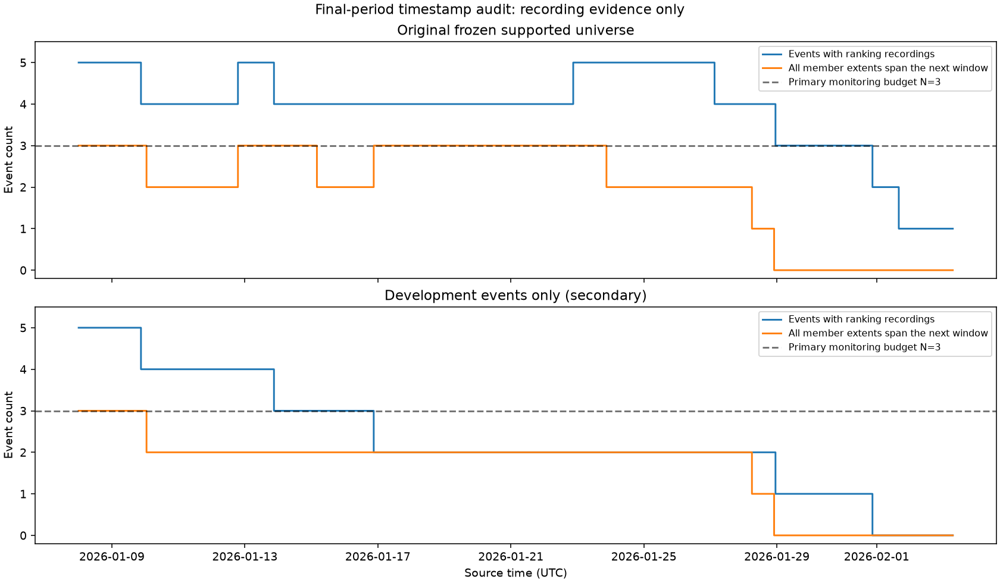

# Final-test coverage and fixed evaluation protocol

## Status

This document records the pre-outcome audit and protocol freeze. The separate
[final evaluation](final_evaluation.md) has subsequently been completed using
these choices; statements about unopened outcomes below describe the audit stage.

The final period's **recording timestamps have been inspected**. Final-period
prices, opportunity labels, model predictions and trading returns have not been
inspected or calculated by this audit. The saved final models remain unchanged.

The machine-readable protocol is
[`results/final_protocol/protocol.json`](../../results/final_protocol/protocol.json).
It is hashed with the prepared model bundle and the timestamp-audit manifest.
It records choices before final outcomes are examined; it is not a claim of
preregistration before development analysis. N=3 and the shortlisted models were
chosen using repeatedly inspected development results.

## Period and stopping rule

The evaluation interval is **8 January 2026, 00:00 UTC to 3 February 2026,
08:00 UTC**, with the endpoint excluded. It contains **632 one-hour windows**;
the last scan is 3 February at 07:00 UTC.

The stopping rule uses the latest source timestamp in any required token file
from the original supported universe, rounded down to the hourly boundary. That
timestamp is 3 February at 08:22:38.393 UTC. The incomplete terminal hour is
excluded. Earlier hours with incomplete recordings remain in the interval; the
endpoint is not shortened to improve coverage, opportunity counts or profits.
This is a recording endpoint, not a verified event-resolution or trading-close
time.

## Frozen universe and available evidence

The original structural plan supports **46 negRisk and five audited ladder
events**, using 994 required token files. Development produced examples for 48
of these events. The other three were already in the frozen universe; they are
not newly discovered after examining final outcomes.

The primary final pool uses the original supported universe. A secondary view
retains only the 48 events with development examples. This distinguishes
generalisation to later observations from inclusion of previously unseen events.
The three events without development examples are Australian Open winner,
next country the US strikes, and the date of the next US strike on Iran.

Only **eight negRisk events**, with **146 token files**, have post-cutoff
observations. All five ladder events lack both later recordings and an audited
entry window extending into the test. Extending the administrative loader
boundary does not extend a ladder contract's validity.

| Event | In development | Tokens with later records / required | Eligible final hours | Hours bracketed by all member extents |
| --- | --- | ---: | ---: | ---: |
| Australian Open winner | No | 33 / 34 | 235 | 0 |
| Musk tweets, 2–9 January | Yes | 10 / 30 | 45 | 0 |
| Musk tweets, 6–13 January | Yes | 25 / 30 | 141 | 0 |
| Musk tweets, 9–16 January | Yes | 30 / 30 | 213 | 49 |
| January Fed decision | Yes | 4 / 4 | 503 | 502 |
| Next country the US strikes | No | 12 / 12 | 246 | 168 |
| Next US strike on Iran date | No | 21 / 21 | 517 | 57 |
| Best AI model at January end | Yes | 11 / 11 | 573 | 486 |

**Eligible** means required tokens have been seen by the scan and the scan is
inside the event's recording extent, matching the development feature-grid
convention. A token that was seen but later stopped recording does not remove
the event from a ranking based on future coverage. Its carried snapshot can
still produce features. Event-level recording extent is an offline observation
mask, not a live event-deactivation signal or predictor.

**Bracketed by all member extents** means that each required token's first and
last recording timestamps surround the relevant monitoring interval. This is a
timestamp diagnostic, not a usable-label count. Malformed/crossed books or
metadata problems may reduce usable coverage; conversely, an observed blocking
leg can make a package decidable despite another missing leg. Timestamp gaps
also cannot distinguish an unchanged book from missing updates. Full label
validation remains necessary under the existing carry-forward assumptions.

There are **2,473 eligible event-hours**, of which **1,262** satisfy this strict
extent diagnostic. These counts reveal no opportunity frequency or P&L.

## How much ranking competition exists?

| Recording-pool diagnostic | Original supported universe | Development events only |
| --- | ---: | ---: |
| Scheduled hours | 632 | 632 |
| Hours with any eligible event | 632 | 573 |
| Maximum eligible events | 5 | 5 |
| Median eligible events, including empty hours | 4 | 2 |
| Hours with more than 3 eligible events | 503 | 141 |
| Nonempty hours where N=3 monitors everything | 129 | 432 |
| Hours with more than 5 eligible events | 0 | 0 |
| Hours with more than 3 extent-bracketed events | 0 | 0 |

N=3 imposes a selection constraint in **79.6%** of the primary pool's hours.
However, that competition includes events with incomplete member recording
extents. The test can measure how policies allocate limited monitoring slots
in this imperfectly recorded cohort; it has limited power to establish a broad
ranking advantage among many fully observable opportunities.

**N=5 is a monitor-all resource reference throughout this final period.** Every
policy should select the same eligible events at that budget. Any differences
in resulting selections or deterministic replay require investigation rather
than interpretation as predictive superiority.



## Fixed model and metric comparison

Use hourly screening, **N=3 primary and N=5 secondary**. The primary value-model
candidate is the saved combined-feature two-stage TabM. Its primary measure is
**peak quoted-value capture at N=3**, compared with quoted-gap. Fixed book-only
logistic regression is the occurrence reference, assessed by positive-hour
recall. Report the fixed forest and both N=3-retuned classical models as well.
There is no refitting, calibration, seed selection or feature selection on the
final period.

The two saved final forest names point to the same fitted model. Verify their
predictions are identical and do not count them as separate supporting evidence.
The earlier N=5-tuned TabM remains a development comparator; it does not have a
separately prepared full-development final fit in this protocol.

References comprise quoted-gap, exact expected random capture, 20 seeded random
policies for replay, and monitor-all. Random seeds are fixed at
20261001–20261020. Ranking uses descending score, then ascending event slug for
ties, selecting up to N without a learned abstention threshold.

Rank the entire eligible pool before consulting labels. Unknown outcomes consume
monitoring slots and are excluded from fitting and known-target denominators;
they are never converted to negative or zero-value labels. Report selected
unknown counts and their share of the monitoring budget. Undefined metrics with
zero denominators remain missing alongside their counts.

Secondary prediction diagnostics include known precision, average precision,
new-onset capture absent at screening, competitive-hour capture and token-level
monitoring burden. Report the full fixed interval and the competitive subset
separately, preserving the original ranked pool for each scan. Captured peak
quote dollars remain a weighting measure, not collectible trading profits.

## Fixed execution comparison

The primary replay uses **100 ms arrival, uncapped capital/shares, no imposed
random failure rate and a one-second partial-basket unwind**. Preserve the
development qualification rules, minimum sizes, tick checks, per-leg execution
and persistent liquidity ledger. Zero exchange fees and zero extra attempt
costs retain the frozen cohort scenario. The five declared arrival delays are
0, 50, 100, 250 and 500 ms.

Start each independent policy/scenario with an empty inventory and ledger at
8 January. Carry reservations across all subsequent hours; do not mix in
in-sample trading from the final model's development history. Entries stop at
the fixed endpoint. Recorded context through endpoint + 1.1 seconds may resolve
existing attempts only. Missing exit evidence remains unknown.

Report completed-basket margin, partial-fill P&L, known net P&L, unknown attempts
and committed cash, completion rate, drawdown, funding scenarios and conversion
of selected opportunities into trades. Completed guaranteed margins are booked
at completion rather than settlement cash receipt. Monitor-all is a resource
reference, not a guaranteed P&L upper bound.

As symmetric secondary diagnostics, report event/family contributions and
leave-each-event-out reranking at the primary budget and latency. Use paired
family resampling only where meaningful, with seed 2026 and 10,000 draws;
disclose small family counts and undefined intervals. Do not treat correlated
event-hours as independent observations. Any changes after seeing final outcomes
must be reported as exploratory extensions.

## Implementation and reproducibility

The audit reads only raw `snapshot_time` columns or their parquet footer
statistics, and development event keys. It does not parse bids, asks or final
labels, calculate predictions or run trading. Timestamp hashes and extent
inventories identify this audit's evidence; they do not replace whole-price-file
verification before replay.

Reproduce into fresh directories:

```powershell
.\.venv\Scripts\python.exe -m src.data.final_coverage --output results/runs/final_coverage_new
$env:MPLBACKEND = 'Agg'
.\.venv\Scripts\python.exe -m src.reporting.final_protocol --audit results/runs/final_coverage_new --output results/runs/final_protocol_new
```

[Notebook 10](../../notebooks/10_final_coverage.ipynb) displays and verifies the
saved audit and protocol. No existing development loader, book reader, source
manifest or model artifact was modified by the audit. The subsequent explicit
final-only feature/label/replay runner is documented in the final findings.
It preserves backward-as-of alignment, uses the previous
scheduled snapshot across the test boundary, validates raw input hashes and
retains the existing development split guards.

The next execution should implement this fixed protocol and report the outcome
even if the test has few opportunities, weak model differences or no advantage
over simple baselines. This cohort cannot support a final-period ladder claim
or establish market-wide performance.
