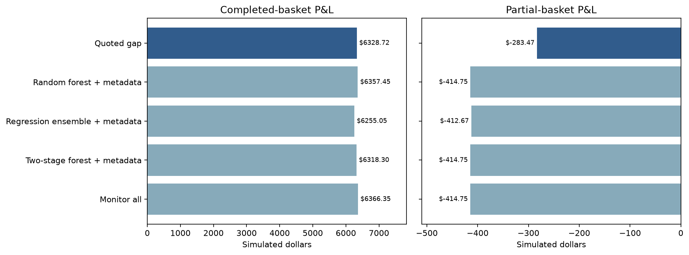
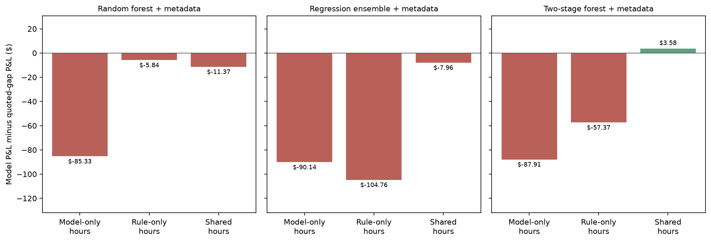
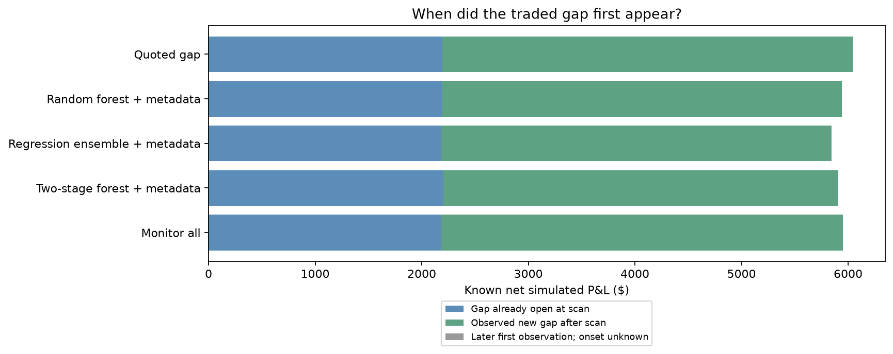

# Why the quoted-gap rule leads the Dome development comparison

The quoted-gap rule earns the highest observed net P&L among the main fitted
model variants, but the advantage over the strongest random forest is small
and depends on one partial-fill loss. The forest captures more hours with
newly emerging profitable opportunities. These findings support separating
opportunity prediction from execution economics; they do not establish that
the quoted-gap rule systematically predicts execution failures.

## Scope and accounting

This analysis uses the existing out-of-sample development predictions and
persistent strategy replay from **1 November 2025 through 7 January 2026**.
No models were retrained, no rankings or execution settings were changed,
and the final test beginning 8 January remains unopened.

The comparison retains 100 ms assumed arrival, uncapped capital and integer
share quantities, displayed-depth sizing, fixed pre-arrival limits and a
one-second partial-basket unwind. There is no additional imposed failure
probability. The same market and execution rules apply to every policy.

There are **1,632 screening hours**, **20,951 eligible event-hours**, and
**44 distinct events** represented in evaluation. The larger prepared
development dataset contains 48 events because it also includes earlier
training observations. Between 3 and 19 events are eligible at a scan; the
average is 12.84. There are 1,437 hours with more than five candidates, so
195 hours offer no top-five selection competition. Each five-event policy
selects 8,034 event-hours in total.

The analysis covers all 24 main learned variants, the quoted-gap, depth and
freshness rules, and monitor-all. Detailed comparisons below show the strongest
observed development variant in each model family. This is a descriptive choice
after seeing development results, not a final-test winner declaration.

All dollar attribution uses **actual persistent replay attempts**, never a sum
of standalone hourly training targets. Attempt outcomes are assigned to the
screening window that authorised monitoring; their execution times remain in
the detailed artifacts. Unknown hourly labels still compete in rankings.

## 1. What determines the overall ordering?

| Policy | Completed-basket P&L | Partial-basket P&L | Net P&L | Attempts |
| --- | ---: | ---: | ---: | ---: |
| Quoted-gap rule | $6,328.72 | −$283.47 | **$6,045.25** | 491 |
| Random forest with metadata | $6,357.45 | −$414.75 | **$5,942.71** | 513 |
| Direct-regression ensemble with metadata | $6,255.05 | −$412.67 | **$5,842.39** | 458 |
| Two-stage random forest with metadata | $6,318.30 | −$414.75 | **$5,903.55** | 496 |
| Monitor all eligible events | $6,366.35 | −$414.75 | **$5,951.60** | 521 |

The forest earns **$28.73 more completed-basket profit** than quoted-gap but
incurs **$131.28 more partial-basket loss**. Its final deficit is **$102.54**,
about 1.7% of the quoted-gap total. All 17 losing attempts taken by quoted-gap
also occur in the forest replay; the forest takes one additional losing attempt.



The observation that monitor-all earns less than quoted-gap has the same
interpretation: monitoring more events can admit an additional losing trade.
Monitor-all is a reference policy, not a guaranteed net-profit upper bound.

## 2. How different are the monitoring choices?

The forest and quoted-gap share **7,123 of 8,034 selected event-hours (88.66%)**.
Restricting the denominator to hours with more than five candidates lowers
that overlap to **87.32%**. Each policy has 911 selected event-hours that the
other does not select.

Actual replay P&L can be separated by whether both policies selected the
event-hour:

| Selection category | Forest P&L | Quoted-gap P&L | Forest minus rule |
| --- | ---: | ---: | ---: |
| Selected only by forest | −$85.33 | $0.00 | −$85.33 |
| Selected only by quoted-gap | $0.00 | $5.84 | −$5.84 |
| Selected by both | $6,028.04 | $6,039.41 | −$11.37 |
| **Total** | **$5,942.71** | **$6,045.25** | **−$102.54** |

Shared event-hours need not produce identical trades. Each strategy carries
its own earlier quote reservations into the hour. Earlier selections can
therefore change which later attempts are permitted. The shared-hour
difference is a historical-policy effect, not different fill rules.

Matching individual attempts by event, screening time, basket and entry time
gives an independent reconciliation:

| Attempt membership | Attempts | Forest P&L | Quoted-gap P&L |
| --- | ---: | ---: | ---: |
| Both policies | 477 | $6,027.85 | $6,027.85 |
| Forest only | 36 | −$85.14 | $0.00 |
| Quoted-gap only | 14 | $0.00 | $17.40 |

Every matched attempt has the same recorded P&L. The difference comes from
which attempts occur, including the consequences of different prior selections.
Among the forest-only attempts, 35 earn $46.13 combined and one loses $131.28.



## 3. The decisive partial-fill loss

The largest model-only loss is in **the December Fed-decision event on
19 November 2025**. This case was chosen retrospectively because of its
contribution to the observed difference.

At the **17:00 UTC scan**:

- The event's best quoted dollar margin is **−$0.09**.
- Quoted-gap ranks it **sixth**, outside the top five. The fifth-ranked
  Honduras election event scores **−$0.085**, just $0.005 higher.
- The forest ranks the Fed event **second**. The direct-regression ensemble
  ranks it third and the two-stage forest second.

The quoted-gap rule therefore avoids the later loss through an ordinary
ranking cutoff. There is no execution-risk classifier in the rule, and this
small score difference does not establish that it anticipated a failure.

The later trade can be reconstructed directly from the raw development books:

| Time, UTC | Observation or simulated action |
| --- | --- |
| 17:24:06.666 | A new gap appears. Submit 3,171 shares of each of four YES tokens. Quoted gross profit is **$4.191**. |
| 17:24:06.727 | The 25-basis-point-cut token's depth within the $0.43 limit falls from **3,171.49 to 1,171.49 shares**, 61 ms after submission. |
| 17:24:06.766 | At the assumed 100 ms arrival, that leg cannot fill the full 3,171 shares. The other three legs fill under the simulator's per-leg fill-or-kill assumptions. |
| 17:24:07.766 | The three filled legs are unwound at recorded bid depth, one second after arrival. |

The filled legs cost **$1,803.2790** and unwind for **$1,672.0018**, giving
**−$131.2772**. Of this loss, $124.9352 comes from the no-change token and
$3.1710 from each of the other two filled legs. The raw-book reconstruction
matches the saved replay loss.

This is a recorded-depth change applied through the existing simulator,
not an imposed random failure. Actual venue fills, queue competition and
cross-leg execution are still assumptions of the replay.

The forest-selected event-hour contains six attempts: five profitable attempts
and this loss. Its standalone net target is **−$124.3772**, while its occurrence
target is positive. An occurrence classifier can therefore correctly identify
an hour containing a profitable attempt while selecting an economically losing
hour. The regression and two-stage policies also select it, so changing the
learning objective alone has not solved that problem.

If the single loss is removed **only from the accounting**, with all other
attempts held fixed, the forest would lead quoted-gap by **$28.73**. This is
a sensitivity calculation, not a valid revised backtest: removing an attempt
could change subsequent reservation state, and a real strategy cannot remove
a trade after learning its outcome. The loss remains in every primary result.

## 4. Are the strategies only recognising gaps already visible at screening?

No. We distinguish three categories using the saved signal's original start:

1. **Visible at scan:** the traded gap started at or before the screening time.
   This includes a continuing gap carried across an hourly boundary.
2. **Observed new gap after scan:** the gap starts strictly later and the
   preceding state was observed. This is the existing dataset's onset criterion.
3. **Later first observation, onset unknown:** a gap is first seen after the
   scan without sufficient preceding evidence to call it newly formed.

| Policy | Gap visible at scan | Observed new gap after scan | Later observation, onset unknown |
| --- | ---: | ---: | ---: |
| Quoted-gap rule | $2,194.56 (78 attempts) | **$3,849.32 (412)** | $1.37 (1) |
| Random forest with metadata | $2,186.31 (76) | **$3,755.03 (436)** | $1.37 (1) |
| Direct-regression ensemble with metadata | $2,185.75 (76) | $3,655.26 (381) | $1.37 (1) |
| Two-stage random forest with metadata | $2,201.27 (81) | $3,700.91 (414) | $1.37 (1) |

Approximately **63.7%** of quoted-gap net P&L comes from gaps opening after
the scan. However, a newly opening basket gap can occur in an event that had
another positive margin at screening. Applying the stricter condition that
the event's best quoted score was nonpositive at screening leaves **$2,964.79**
from 354 observed-new-gap attempts, about **49.0%** of quoted-gap net P&L.
The corresponding forest figure is $2,870.50 from 378 attempts.



The rule can do this because it still selects the highest-ranked negative
scores when fewer than five scores are positive. It is often selecting events
close to a quoted arbitrage, then monitoring them for subsequent changes.
That is a plausible explanation of its forward usefulness; this analysis
does not establish a universal relationship between distance from arbitrage
and future opportunity formation.

These categories describe recorded basket-gap onsets, not independent economic
opportunities. Multiple attempts or hourly continuations can belong to one
episode. New recorded onsets also inherit the capture and carry-forward
assumptions of the underlying data.

## 5. What predictive value do the models show?

There are **376 fully labelled evaluation event-hours** containing at least
one profitable attempt. Of these, **242** contain a profitable attempt from
an observed gap onset strictly after the scan. The subsets overlap with
already-visible opportunity hours; they are not disjoint populations.

| Policy | Captured profitable-attempt hours | Captured future-onset profitable hours |
| --- | ---: | ---: |
| Quoted-gap rule | 345 / 376 = **91.76%** | 211 / 242 = **87.19%** |
| Random forest with metadata | 360 / 376 = **95.74%** | 226 / 242 = **93.39%** |

Under the stricter condition of a nonpositive quoted score at the scan, the
forest captures **207 of 223** known hours with a later profitable attempt,
versus **192 of 223** for quoted-gap. Thus the forest identifies 15 more such
hours, while the rule retains the better net P&L. This is evidence of useful
opportunity detection in this development sample, not evidence of higher
economic value or generalisation to unseen market families.

Both methods select **all 187 event-hours with positive quoted scores**.
Only 178 of those satisfy the stricter entry qualification at the scan:
the ranking feature does not require the simulator's positive worst-limit
margin. The forest's improvement is therefore not from selecting more of
the already-positive quoted states.

The candidate pool also includes 12,780 event-hours with an unavailable
quoted score. Of these, 10,144 have known labels and none contains a profitable
attempt; the remaining labels are unknown and must not be treated as negative.
Quoted-gap selects 1,410 unavailable-score event-hours, the forest 1,422,
and the regression ensemble 2,693. Missing scores are a useful diagnostic
of the ranking behaviour, but this retrospective result does not justify
silently excluding those candidates from the primary comparison.

## 6. How stable is the apparent lead?

The forest-versus-rule net difference changes across evaluation folds:

| Evaluation fold | Quoted-gap net P&L | Forest net P&L | Forest minus rule |
| --- | ---: | ---: | ---: |
| 1–21 November | $4,622.71 | $4,500.13 | −$122.58 |
| 22 November–14 December | $1,090.61 | $1,110.64 | +$20.03 |
| 15 December–7 January | $331.93 | $331.93 | $0.00 |

The rule wins the first fold, the forest wins the second, and all displayed
representative policies have identical final-fold P&L. Identical returns do
not mean identical complete shortlists; many alternative selections produce
no trades.

The December Fed event contributes **$5,332.95**, or about **88.2%**, of
quoted-gap net P&L. The existing concentration test removes that event and
reranks the remaining pool, using unchanged fitted models:

| Policy | Net P&L after removing December Fed and reallocating slots |
| --- | ---: |
| Quoted-gap rule | **$726.57** |
| Random forest with metadata | **$726.81** |
| Direct-regression ensemble with metadata | $682.06 |
| Two-stage random forest with metadata | $717.97 |

The forest and quoted-gap are effectively tied in this sensitivity, with
the forest ahead by $0.24. It is a post-hoc concentration check, not an
independent replication or retraining without Fed data.

## 7. Coverage and interpretation limits

All compared persistent attempts have known outcomes, but that does not mean
all monitored hours are fully observed. Quoted-gap selects 1,518 unknown-label
event-hours and the forest 1,409. Each has 101 observed, priceable attempts
inside unknown-label hours, contributing $318.35. Their known-trade subtotal
can be reported, but those hours cannot supply a complete training target or
prove the absence of other missed opportunities.

The analysis does not validate historical 100 ms trading performance. For
quoted-gap's new-onset attempts, the median age of the oldest required leg
at submission is about 173 seconds; unchanged older quotes are carried forward
under the existing complete-capture assumption. Age alone does not distinguish
an unchanged book from an unrecorded update. The disputed loss has a recorded
61 ms depth change, but this does not establish equally precise capture for
every other leg or attempt.

Repeated hours within the same events and episodes are not independent
experiments. This report adds no significance claim or new model search.
The existing family-bootstrap intervals are exploratory; neither they nor
the small headline P&L gap establish a universally superior policy.

## 8. What this suggests for the research

The evidence supports a narrower and more useful conclusion than simply
"the rule beats ML":

- Both the rule and the strongest forest allocate monitoring to events that
  later develop new recorded gaps; the experiment is not solely immediate
  gap recognition.
- The forest captures more profitable-opportunity hours, but that does not
  translate into higher net P&L once partial execution losses are retained.
- One additional partial-fill loss reverses the rule-versus-forest ordering.
  This calls for caution about interpreting either method's small advantage.
- More direct P&L objectives do not automatically improve the result. The
  regression ensemble misses profitable selections as well as taking the
  disputed loss, and shows a larger shift toward unavailable quoted states.
- The next modelling hypothesis should concern incremental value beyond the
  quoted margin, evaluated with the same losses and coverage rules. The
  present case must not become a hand-crafted exclusion or justify removing
  partial-fill losses from the simulator.

## 9. Monitoring budget and the limits of the dataset

Five monitoring slots do not cover all eligible events in most hours: this
happens in **195 of 1,632 hours (11.9%)**. However, the total candidate count
overstates competition between events with calculable quoted margins. There
are only **5.01 such events per scan on average**, and five slots cover all
of them in **910 hours (55.8%)**. A calculable quoted margin is not a new
eligibility requirement or proof of subsequent recording coverage; these are
two different descriptions of the same unchanged candidate pool.

| Budget | Hours when all eligible events fit | Hours when all events with a quoted score fit | Selected event-hours |
| --- | ---: | ---: | ---: |
| 5 | 195 / 1,632 = 11.9% | 910 / 1,632 = 55.8% | 8,034 |
| 3 | 8 / 1,632 = 0.5% | 464 / 1,632 = 28.4% | 4,896 |

Thus a tighter budget provides a meaningful additional ranking test. Top three
was already included in the saved ranking-metric budget set. Its additional
persistent replay uses the same fitted predictions and execution assumptions,
and is stored separately from the unchanged primary top-five replay. It is
not valid to substitute sums of selected training targets for this replay.

The completed persistent replay gives the following development-period net
P&L, with 100 ms arrival latency and uncapped capital and share quantities:

| Policy | Top 3 | Top 5 |
| --- | ---: | ---: |
| Combined random forest | $5,910.43 | $5,942.71 |
| Combined regression ensemble | $4,488.07 | $5,842.39 |
| Combined two-stage random forest | $5,838.89 | $5,903.55 |
| Quoted-gap rule | $4,379.96 | $6,045.25 |
| Monitor all | $5,951.60 | $5,951.60 |

Monitor-all is the same unrestricted reference in both columns. At three
slots, the forest exceeds quoted-gap by **$1,530.47**. It retains 99.46% of
its own top-five P&L while selecting 39.1% fewer event-hours. It captures
195 of 242 labelled hours containing profitable opportunities with an
observed onset after screening, compared with 134 for quoted-gap. Thus
the broader monitoring budget does obscure a meaningful selection difference
in this dataset. These are fixed-model comparisons: no models were retrained
and the final test was not opened.

However, concentration remains decisive. When the December Fed event is
excluded and policies are reranked and replayed, top-three net P&L is
**$655.87 for the forest versus $729.50 for quoted-gap**. The two-stage forest
earns $682.70 and the regression ensemble $654.99. The ordering therefore
reverses outside the dominant event. The larger full-pool forest advantage
does not establish that it generalises across event families. The smaller
budget also retains partial-fill losses: the forest's completed-basket profit
is $6,324.41, offset by $413.98 of partial-execution losses.

The Dome dataset supports a scoped comparison of periodic screening policies
for its selected negRisk and ladder contracts. It does not establish generic
Polymarket-wide arbitrage-detection performance. Important limits are the
small number of distinct events, only five ladder events in the prepared
study, retrospective universe selection, incomplete observation coverage,
strong concentration in one Fed event, few independent losing episodes and
unverified attainability of historical displayed liquidity at 100 ms.

Reducing the budget changes how scarce monitoring slots are; it does not add
independent market regimes, settlement structures, events or execution cases.
A stronger external-validity study would need independently selected events
across categories and periods, complete required-token histories, adequate
simultaneous candidate coverage, and chronological evaluation that also checks
transfer to unseen events or families. A larger event count alone is insufficient.
These requirements concern data quality and study design, not a particular
data provider.

The appropriate budget should ultimately reflect the intended resource
constraint. Both three and five should remain visible in the dissertation;
choosing a budget solely because it makes a particular model win would weaken
the comparison. Event-hour slot counts are not measured processing savings:
periodic screening overhead and differing event update rates still matter.

## Reproduction and artifacts

Run [notebook 04](../../notebooks/04_selection_diagnostics.ipynb). It verifies
the saved diagnostic hashes and displays the selection, onset, trade, raw-book
case and concentration tables. Its rebuild option creates a separate output
folder without changing the active dataset, fitted models or replay.

The reusable implementation is
[`src/reporting/selection_diagnostics.py`](../../src/reporting/selection_diagnostics.py).
To generate a fresh analysis from the active profitability run:

```powershell
.\.venv\Scripts\python.exe -m src.reporting.selection_diagnostics --output results/runs/selection_diagnostics_new
```

The canonical outputs are under
[`results/profitability/selection_diagnostics/`](../../results/profitability/selection_diagnostics/):

- `policy_summary.csv`, `selection_attribution.csv`, `fold_summary.csv` and
  `event_contributions.csv`: aggregate comparisons and exact dollar attribution.
- `onset_breakdown.csv` and `scan_states.csv`: future-onset and screening-state
  diagnostics, with labelled-hour denominators kept separate from replay P&L.
- `selected_windows.parquet`, `annotated_attempts.parquet` and
  `attempt_comparisons.parquet`: row-level evidence behind those tables.
- `loss_case.json`, `loss_case_books.csv` and `loss_case_rankings.csv`: the
  retrospective case study, including raw quote timestamps and depth.
- Three PNG figures, `manifest.json` and `complete.json`: readable comparisons,
  input provenance, execution settings and output hashes.

The separate `results/profitability/budget_sensitivity/` folder contains the
top-three replay and the matched budget comparison. Notebook 04 exposes its
replay control; `src/reporting/monitoring_budget.py` checks the shared inputs
and execution settings before reporting results. It does not change the
active primary replay pointer.
